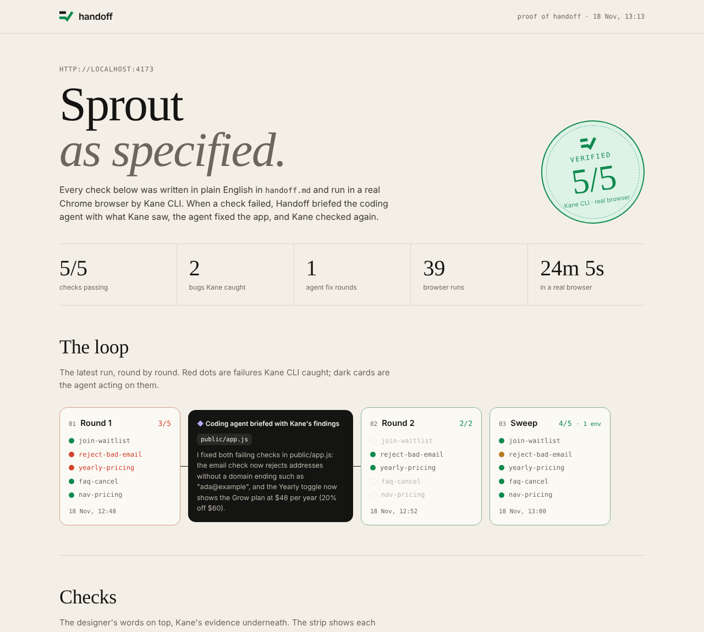

<p align="center">
  <picture>
    <source media="(prefers-color-scheme: dark)" srcset="docs/handoff-brand/01-logo/horizontal/svg/handoff-horizontal-color-dark.svg">
    
  </picture>
</p>

<p align="center"><b>Your AI agent says "done". Handoff makes it prove it.</b></p>

<p align="center"></p>


A designer writes what must be true in plain English. A coding agent builds it and says "done". Then someone has to click through it and find that the email field accepts `ada@example`, or that the yearly price forgot the discount.

Handoff removes that someone. Every check in `handoff.md` runs in a real Chrome browser through [Kane CLI](https://www.testmuai.com/kane-cli/). When Kane catches a failure, Handoff turns what Kane saw into a precise brief and hands it back to the coding agent. Then it makes Kane check again, until the spec is green. Finally it publishes a **proof page** that a designer, PM or client can actually read.

```
handoff.md ──▶ Claude Code builds ──▶ Kane CLI checks in a real browser
     ▲                                          │
     └──── fix brief: what Kane saw ◀───────────┘   until every check passes
```

## What a real run looks like

From the demo in `examples/sprout`, run on Windows with real Kane CLI and real Claude Code:

```
── Round 1 · Kane CLI verifies the build ──────────────────────
[3/5] yearly-pricing  Scroll to "Simple pricing", click "Yearly", verify the Grow plan shows "$48"…
    ◉ scroll: Scrolling to the Simple pricing section
    ◉ click: Clicking the Yearly button in the Simple pricing section
    ✖ FAIL 1m 24s  The Grow plan shows $60 per year after Yearly is selected, instead of the required $48.
      Kane read "$60" · expected "$48"
── Agent · fixing 2 failing checks ─────────────────────────────
    ◆ read public/app.js
    ◆ edit public/app.js
── Round 2 · Kane CLI re-checks what failed ────────────────────
    ✔ PASS  submitted an invalid email to the waitlist on localhost
    ✔ PASS  selected yearly pricing on the Simple pricing page
```

And inside an interactive Claude Code session, Claude isn't allowed to finish until Kane agrees:

```
Stop says: Handoff ✔ 6/6 checks verified in a real browser by Kane CLI — proof: .handoff/proof.html
```

## Why it's different

- **The spec belongs to the designer, not the test engineer.** Checks read like acceptance criteria: *Click "Yearly" and verify the Grow plan shows "$48" per year.* There are no selectors and no test code.
- **Kane's verdict closes the loop, not a human.** There are two ways in:
  - **Claude Code Stop hook.** Every time Claude says it's done, Kane verifies. A failure blocks the stop (exit 2), and Kane's findings become Claude's next instruction. Fail-fast: new and failing checks run first. Builds that haven't changed are skipped, so no credits are wasted.
  - **`handoff loop`.** This runs headless: verify, brief Claude Code (`claude -p`), re-verify what failed, then do a regression sweep of every check.
- **Handoff reads Kane's own judgement before blaming anyone.** Kane reports *why* a run failed, and Handoff acts on it:

  | Kane says | Handoff does |
  |---|---|
  | The app is wrong (`objective_contradiction`, a value mismatch) | Briefs the agent with the evidence: *Kane read "$60", the spec expects "$48"* |
  | Its own automation slipped (`automation_bug · agent_misstep`) | Re-runs the check before anyone touches the code |
  | The platform failed (`environment_issue · infra_error.screenshot_failed`) | Re-runs, then reports it as an environment problem and **never** asks the agent to "fix" working code |

- **Fix the app, not the check.** The brief carries the spec's brand rules and forbids weakening checks.
- **Proof, not logs.** `.handoff/proof.html` shows the designer's words, Kane's evidence and readouts, a link to every Kane run report, the loop round by round, the brand, and the run history. You also get a `badge.svg` for your README.

## Quick start

```bash
npm install -g @testmuai/kane-cli && kane-cli login
npm install -g github:esteexbt/handoff        # or: git clone … && npm link

cd your-app
handoff init --url http://localhost:3000      # creates handoff.md + installs the Claude Code Stop hook
handoff verify                                # every check, real browser
handoff loop --open                           # let Claude Code fix what Kane catches
```

Try the demo. Its first-pass build has two realistic bugs planted in it, the kind agents leave every day: email validation that only checks for `@`, and a yearly price that forgot the discount.

```bash
cd examples/sprout
handoff verify                 # Kane catches the 2 bugs
handoff loop --headed --open   # watch Kane in Chrome, Claude Code fixes, the proof page opens
```

## handoff.md

```markdown
---
name: Sprout
url: http://localhost:4173
start: node server.js          # optional: Handoff starts the app if it's down
---

# Sprout
Context for the agent: what this is, who it's for.

## Brand
- Sprout green: #1F6F4A
- Voice: calm and short. No exclamation marks.

## Checks
- join-waitlist: Enter "ada@example.com" in the email field, click "Join the waitlist", and verify the page shows "You're on the list"
- yearly-pricing [/pricing]: Click "Yearly" and verify the Grow plan shows "$48" per year
```

Each check becomes one `kane-cli run --agent --headless "<check>" --url <url>`, and Handoff parses Kane's NDJSON stream. `[/path]` starts a check on another page.

## Commands

| Command | What it does |
|---|---|
| `handoff init` | Creates `handoff.md` and adds the Stop hook to `.claude/settings.json` |
| `handoff verify [--only a,b] [--headed]` | Runs checks through Kane CLI. Exits non-zero on failure, so it works in CI |
| `handoff loop [--max 3] [--headed] [--open]` | Verify, brief the agent, fix, re-verify, until green |
| `handoff proof` | Rebuilds and opens the proof page |
| `handoff brief` | Prints the exact brief the agent receives for the last failures |
| `handoff doctor` | Checks kane-cli, Claude Code, the spec and the app |

`--headed` shows the real browser, which is great for demos.

## How the loop talks

| Kane CLI exit | Meaning | Handoff does |
|---|---|---|
| `0` | passed | Records the evidence and the Kane report link |
| `1` | assertion failed | Reads Kane's verdict, then either briefs the agent or re-runs if Kane blames itself |
| `2` | environment error | Reports it and never asks the agent to fix code that isn't broken |
| `3` | timeout | Re-runs if Kane marks it as infra, otherwise treats it as a failure |

The Stop hook allows 3 attempts per Claude session (`HANDOFF_MAX_ATTEMPTS`), then hands control back to you, so it never loops forever.

## Under the hood

Zero dependencies, Node 18+. Built and tested on Windows, and also runs on macOS and Linux. On Windows, npm's `.cmd` shims are resolved to their real entry points, so plain-English checks full of quotes reach Kane intact. `npm test` runs the full loop against test doubles, and the real runs behind the proof page are committed in `examples/sprout/.handoff/runs/`.

---

Built for the [Kane CLI Hackathon](https://kaneclihack.sh). Design by Estee ([@esteexbt](https://x.com/esteexbt)). MIT.
